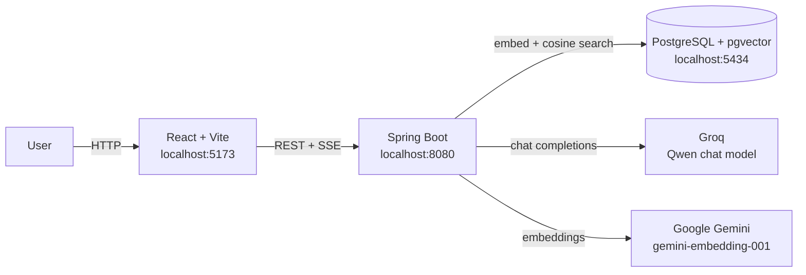
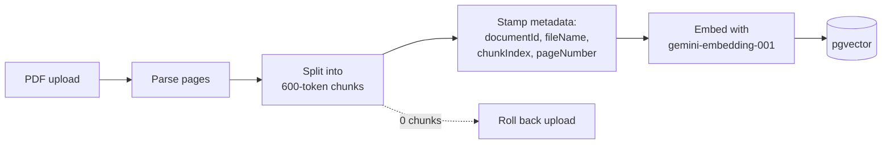
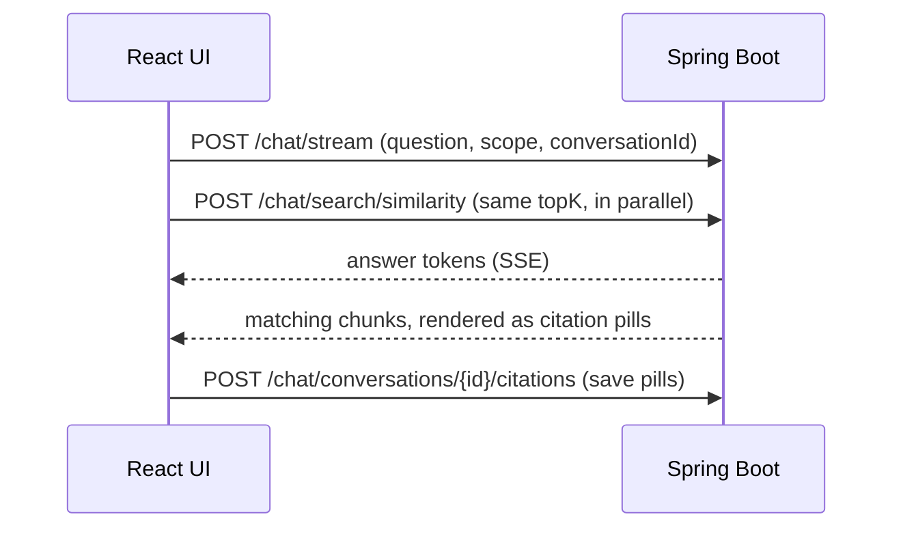
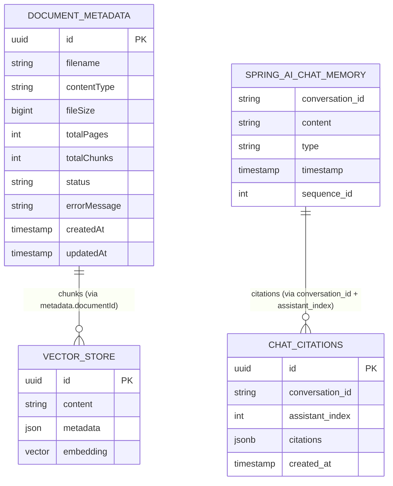

<div align="center">

# 📄 DocLens

### Ask your PDFs anything. Get answers you can verify.

An AI document assistant built on **retrieval-augmented generation (RAG)**.
Every answer carries **citations to the exact file, page, and chunk** it came from.


[Demo](#-demo) · [Features](#-features) · [Quick Start](#-quick-start) · [How It Works](#-how-it-works) · [Engineering Highlights](#-engineering-highlights) · [API](#-api-reference) · [Improvements](#-scope-of-improvement)

</div>

---

## 🎬 Demo

> ▶️ **Demo video: coming soon** (link to be added)
<!-- TODO: replace the line above with a thumbnail that links to the video:
[](YOUR_VIDEO_URL) -->

**No live deployment by design:** it uses private AI keys, so it runs locally with your own (see [Quick Start](#-quick-start)).

| Chat with citations | Search results |
|---|---|
|  |  |

---

## 💡 Why DocLens

A plain chatbot can sound right and be wrong, and you cannot check it.
DocLens is built so that **you can**:

- Answers are **grounded** in text retrieved from your own PDFs.
- Every answer shows **citation pills** (file · page · chunk) for the source it used.
- A **Chunks view** shows exactly what the model was given.
- Citations are **stored, not re-derived**, so a reloaded chat shows the same pills.

---

## ✨ Features

| Feature | What you get |
|---|---|
| 📤 **PDF upload** | Single or batch, with per-file status: `PROCESSING` → `INDEXED`, or `FAILED` with a reason. A failed upload never leaves a half-saved row. |
| 💬 **RAG chat with citations** | Answers grounded in retrieved text, with pills pointing at the source. |
| ⚡ **Streaming + standard answers** | Token-streamed over SSE, or plain request/response. Both modes produce identical citations. |
| 🔎 **Semantic search** | Retrieval only, no LLM. Chunks with similarity scores, scoped to all documents or one. |
| 🗂️ **Chat history with memory** | Past conversations in a sidebar. Each has its own memory and keeps its citations after a reload. |
| 🧩 **Chunks view** | Inspect which chunks were retrieved for a question or a search. |
| 🎯 **Scope control** | Ask across all documents or narrow a question to a single one. |

---

## 🧭 Quick Start

**Prerequisites:** JDK 21 · Docker · Node 18+

**API keys** (the only required secrets):

| Key | Used for | Get it from |
|---|---|---|
| `GROQ_API_KEY` | Chat model | Groq Console → API Keys |
| `GEMINI_API_KEY` | Embeddings | Google AI Studio → Get API Key |

### 1. Backend

```bash
git clone https://github.com/Raman-25/DocLens.git
cd DocLens/backend

# Start Postgres + pgvector on port 5434
docker compose up -d
```

Set the keys, then run (profile: `dev`):

```bash
# macOS / Linux
export GROQ_API_KEY=<your-groq-key>
export GEMINI_API_KEY=<your-gemini-key>
./mvnw spring-boot:run
```

```powershell
# Windows (PowerShell)
$env:GROQ_API_KEY="<your-groq-key>"
$env:GEMINI_API_KEY="<your-gemini-key>"
.\mvnw.cmd spring-boot:run
```

Running from IntelliJ? Add both keys as environment variables in the run configuration and use the `dev` profile.

API: `http://localhost:8080` · Swagger UI: `http://localhost:8080/swagger-ui.html`

### 2. Frontend

```bash
cd ../frontend
npm install
npm run dev
```

App: `http://localhost:5173`

### 3. Try it

1. Upload a PDF from the sidebar dropzone or the composer's `+` button.
2. Ask a question in **Chat**. The answer streams in with citation pills.
3. Use **Search** when you want chunks only, with no generated answer.
4. Reopen any past conversation from **Chats**. Messages and pills load exactly as they were.
5. Use the scope selector to narrow a question to one document.

<details>
<summary><b>🛠️ Troubleshooting</b></summary>

| Problem | Fix |
|---|---|
| Backend won't start | Port `8080` is busy. Stop the other Spring Boot app. |
| CORS error | Vite left port 5173. Stop stale dev servers and restart on 5173. |
| Chat errors in a long chat | Groq free-tier limit. Start a fresh conversation. |

</details>

---

## 🏗️ How It Works



### Ingestion: PDF → searchable chunks



### Asking a question

1. The frontend sends the question and an optional document scope.
2. The question is embedded with the **same model used at ingestion**. pgvector returns the top-K most similar chunks (cosine similarity, plus a metadata filter when a scope is set).
3. The chunks are assembled into context and sent to the chat model **through the system prompt**, never baked into stored messages.
4. The answer returns with citations.
5. The conversation is saved in Postgres, so a restart never loses history.

### Streaming: how citations still work

The SSE stream carries **tokens only**, so citations travel a separate path:



Non-streaming `/chat/query` answers are saved by the backend automatically.
Search results are never saved.

---

## 🧠 Engineering Highlights

The hard problems in this project are all on the backend: retrieval quality,
memory consistency, and citation integrity.

| # | Problem | Decision | Result |
|---|---|---|---|
| 1 | Answers, memory, and citations live in three separate stores | Tie them together by position: `(conversation_id, assistant_index)` | Streaming and non-streaming modes converge on identical pills |
| 2 | Memory must survive restarts | JDBC-backed chat memory in Postgres, keyed per conversation | A restart never loses history |
| 3 | Retrieved context can pollute conversation memory | Memory stores **raw questions only**. Context travels via the system prompt | Memory stays clean and small |
| 4 | Citations can drift from the answer they belong to | Stored in their own JSONB table at save time, never baked into message text, never re-derived | Reloaded chats show the same pills |
| 5 | Silent retrieval failures are the worst kind | Every chunk is stamped (`documentId`, `fileName`, `chunkIndex`, `pageNumber`). The query filter must match exactly. Empty ingestion (0 chunks) rolls back instead of saving a `FAILED` row | Retrieval fails loudly, not quietly |
| 6 | Users ask about one document or about everything | Scope is first-class on every question and search. Switching chats resets it to All Documents. Switching is locked while streaming | No cross-document answers by accident |

### ⚙️ Key settings

| Setting | Value |
|---|---|
| Chunk size | 600 tokens |
| Default top-K | 3 (`AppProperties`). The Search tab has its own slider |
| Embeddings | `gemini-embedding-001`, 768 dimensions |
| Similarity | Cosine, HNSW index |
| Chat model | Groq · `qwen/qwen3.8-27b` |

---

## 🗄️ Database Design



- Relationships are **logical, not foreign keys**. Chunks link via the `documentId` key in vector-store metadata. Citations link via the `(conversation_id, assistant_index)` unique constraint.
- **Two counters, never mixed:** `sequence_id` orders all messages. `assistant_index` counts assistant messages only.

---

## 🔌 API Reference

Base URL: `http://localhost:8080/api/v1` · Every response uses the envelope
`ApiResponse { success, message, data, timestamp }`. Try them in Swagger UI.

| Area | Method | Endpoint | Purpose |
|---|---|---|---|
| **Documents** | `POST` | `/documents/upload` | Upload one PDF |
| | `POST` | `/documents/upload-multiple` | Upload several PDFs |
| | `GET` | `/documents` | List documents |
| | `GET` | `/documents/{id}` | Get one document |
| | `DELETE` | `/documents/{id}` | Delete a document |
| **Chat** | `POST` | `/chat/query` | Ask a question, full answer in one response |
| | `POST` | `/chat/stream` | Ask a question, answer streamed over SSE |
| | `POST` | `/chat/search/similarity` | Retrieval only, chunks with scores |
| **History** | `GET` | `/chat/conversations` | List conversations |
| | `GET` | `/chat/conversations/{id}/messages` | Load a conversation's messages |
| | `POST` | `/chat/conversations/{id}/citations` | Save citation pills for a streamed answer |

---

## 🧰 Tech Stack

| Layer | Technology |
|---|---|
| **Backend** | Java 21 · Spring Boot 4.1.1 · Spring AI 2.0.1 · Spring Data JPA · Maven |
| **AI** | Groq (chat) · Google Gemini embeddings (768 dimensions) |
| **Data** | PostgreSQL + pgvector (cosine similarity, HNSW index) |
| **Frontend** | React · Vite · JavaScript · custom CSS |
| **Local infra** | Docker (pgvector Postgres) |

> 🔐 API keys live only in backend environment variables. Never in the frontend, never in git.

<details>
<summary><b>🗂️ Project Structure</b></summary>

```
DocLens/
├── backend/                          # Spring Boot API (Java 21)
│   ├── docker-compose.yml            # pgvector Postgres (port 5434)
│   ├── init.sql
│   ├── pom.xml
│   └── src/main/java/com/doclens/doclens_backend/
│       ├── configs/                  # CORS
│       ├── controller/               # Chat, Document, ChatHistory
│       ├── service/                  # ingestion, RAG, chat history
│       ├── repository/               # Spring Data JPA repositories
│       ├── entity/                   # DocumentMetadata, ChatCitation
│       ├── dto/                      # request/response shapes
│       ├── enums/
│       └── exceptions/
├── frontend/                         # React + Vite + JavaScript
│   └── src/
│       ├── components/               # ChatPanel, SearchPanel, ChunksPanel,
│       │                             # Sidebar, UploadDialog, ChunkCard
│       ├── services/                 # API client (envelope unwrap, SSE)
│       ├── constants/
│       ├── styles/                   # per-component stylesheets
│       ├── App.jsx
│       └── main.jsx
└── docs/screenshots/                 # README images
```

</details>

---

## ✅ Quality & Verification

- Each backend module was **verified against the live backend** before moving on to the next.
- A **fresh-clone audit** (clone → setup → run → use) passed **12/12 checks**.

---

## ⚠️ Limitations

- **No auth or multi-user isolation.** Personal demo: one user, one set of keys.
- **No live deployment.** Video and local runs only, because AI calls bill to the owner's keys.
- **Scanned PDFs yield no text.** No OCR yet.
- **Free-tier limits.** Groq input caps and a 500-token response cap. A fresh conversation resolves it.
- **Citations only for newer chats.** Chats from before the citations store have no pills, and they are unrecoverable.

---

## 🚀 Scope of Improvement

- Voice input via Groq Whisper (`whisper-large-v3-turbo`), parked for now
- JWT auth with per-user isolation and quotas
- OCR for scanned PDFs
- Hybrid search (keyword + vector) with cross-encoder reranking
- Retrieval eval harness: groundedness and citation-precision metrics
- Async ingestion queue with progress for large PDFs
- Query rewriting / multi-query retrieval
- Token-aware memory trimming and summarization
- Expanded automated tests (JUnit/MockMvc)
- Env-driven deployment, once the key strategy allows a public demo

---

## 🧑‍💻 Development Approach

The backend was built module by module, with each piece verified against the live
backend before moving on. The interface was developed with AI-assisted tooling,
guided by a defined API contract and design specification, with every piece
reviewed and verified in the same way. The hard problems (retrieval quality,
memory consistency, citation integrity) are all backend, and that is where the work went.

---

<div align="center">

Built by [Raman-25](https://github.com/Raman-25)

</div>
